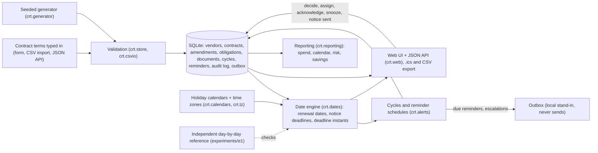

<p align="center"></p>

<p align="center">
  
  
  
</p>

# Contract & Renewal Tracker

> Never miss an auto-renewal notice window, know your commitments, and see spend by vendor.

A local, single-tenant tracker for small businesses. Each contract has an owner, a term, a renewal rule and a notice rule; the tracker computes the whole timeline of renewal dates and **notice deadlines** (month-end clamping, leap years, business-day notice with holiday calendars, time zones), reminds the right person on a schedule that is data, escalates when nobody has decided, records every decision in an audit trail, and reports committed spend by vendor and month. A web UI and a JSON API serve it. Python standard library only: no dependencies to install.

> **It tracks dates and terms that you enter. It does not read or interpret contracts, and it is not legal advice.** Check every computed date against the contract itself.

**Quick links:** [Architecture](#architecture) · [Tech stack](#tech-stack) · [Engineering decisions](#engineering-decisions) · [Roadmap](#roadmap) · [Case study](docs/case-study.md) · [Research report](docs/research-report.md)

> **Public showcase.** This repository holds the documentation, client case study, research report and measured results for this product. The runnable source code is distributed separately under a license: see [SOURCE-ACCESS.md](SOURCE-ACCESS.md).

## At a glance

|  |  |
|---|---|
| **Track** | Business |
| **Phase** | Beta: all five milestones are built and tested and all four experiments have recorded results. It runs locally on synthetic data only; it is not deployed, has no authentication, cannot send email or calendar invitations, has never held a real contract and has not been opened in a browser by a person or audited for accessibility. It tracks dates and terms a user enters, does not interpret contracts and is not legal advice. |
| **Primary reader** | Clients and founders |
| **Read next** | [README](README.md) · [Client case study](docs/case-study.md) · [Research report](docs/research-report.md) |

## Why this exists

Small businesses hold dozens of agreements (software, telecom, insurance, leases, services) and many renew automatically unless someone gives notice weeks or months ahead. The deadline that matters is not the end date: it is the notice deadline, which depends on month lengths, weekends, holidays and whether days are counted as calendar or business days. Nobody owns that calendar, so renewals are discovered on the invoice. Contract-lifecycle suites solve this but bring per-seat pricing, data you do not control and features you do not need.

## What it does (all of this is built and tested)

- **Data model and date engine (M1).** Vendors and counterparties, contracts, terms (start, end, term length, auto-renew, renewal term, maximum renewals, notice period in days, weeks, months or years, calendar-day or **business-day** notice, weekend roll, cutoff time, time zone, holiday calendar, cancellation fee, billing amount and period), amendments that change the terms from an effective date, obligations (one-off or recurring), owners with managers, and **document records (name and location only; file contents are never read or stored)** in SQLite. A **pure date engine** computes the next renewal date, the notice deadline and the full renewal timeline for N years: month-end clamping, leap years, business-day notice with holiday calendars, and the deadline *instant* in the contract's time zone (`zoneinfo` when the machine has the IANA database, otherwise a built-in rule-based stand-in, see limits).
- **Alerts and workflow (M2).** **Reminder schedules as data** (for example 90/60/30/7 days before the notice deadline), snooze (never past the deadline) and acknowledge, a **decision workflow** (renew, renegotiate, cancel) with owner assignment and an audit trail, recording that a cancellation notice was sent (on time or late), **escalation** to a manager and then to a named contact when a deadline nears with no completed decision, and a **local outbox** that stands in for email: every message is recorded as `queued` and never sent.
- **UI and API (M3).** Server-rendered local web UI: dashboard of upcoming deadlines and risks, contract page with the decision workflow and timeline, month calendar and 12-month timeline views, filters (search, vendor, owner, category, lifecycle, status, due window, auto-renew), vendors, owners, outbox, import and export pages. A JSON API covers the same ground. **`.ics` export** of deadlines (and renewals), **CSV import and export** with validation errors reported **per row**. Semantic markup with landmarks, labelled controls and table captions; no accessibility conformance is claimed and none has been audited.
- **Reporting (M4).** Committed spend by vendor and by month (an estimate from entered amounts and billing periods), a 12-month renewal calendar, a notice-window risk list (including deadlines already missed and data gaps such as "auto-renews but has no owner"), savings tracking when a decision renegotiates or cancels (numbers the user types in), and a **seeded synthetic portfolio generator**.
- **Experiments (M5).** E1 date engine vs an independent day-by-day reference, with deliberately broken engines that must be caught; E2 reminder schedules A/B/C with and without escalation on simulated owners; E3 CSV import on generated malformed files; E4 UI/API throughput with machine load disclosed. Raw data and verdicts are in `results/`.

## Not built / out of scope

| Item | Why |
|---|---|
| Reading, parsing or interpreting contracts (OCR, clause extraction, AI summaries) | Out of scope by design: the product tracks dates and terms people enter and gives no legal advice. Every computed date must be checked against the contract. |
| Real email, calendar sync, SMS or chat | Needs provider accounts and credentials. Built as **local stand-ins**: the outbox table (`/outbox`, `/api/outbox`) records what would be sent; `.ics` files are downloaded and imported by hand. |
| Authentication, roles, permissions | Single-tenant local demo bound to `127.0.0.1` with no login. "Acting as" a name is a cookie convenience that labels the audit trail, not a security control. Request hardening (form tokens, Host and Origin checks, JSON content type, CSP) is in place but has not been security reviewed. |
| Multi-tenant isolation, hosted deployment, containers, queues, PostgreSQL | One SQLite file and one process (database work is serialised behind a lock). No container was built. |
| IANA time-zone database | Not available on the build machine (stock Windows Python without `tzdata`, and installing it would be a download). A rule-based stand-in covers 32 named zones plus `UTC±hh:mm` with *current* US, EU, Australian-east and New Zealand rules applied to every year, no history. With `zoneinfo` data present the standard library is used instead; that path is not exercised on the build machine. Experiment E1 does not independently check the zone rules. |
| Holiday calendars | Calendars are data you maintain. One rule-based **example** (US federal, observed dates) is generated; it is not an authority and contracts often define their own business days. No other country calendars. |
| Notice windows with a minimum and a maximum ("between 90 and 60 days before") | One notice period per contract; the deadline is the last day notice may be given. |
| Amendments that change the term mid-renewal | Extension amendments must take effect before the initial term ends; other changes apply to all later cycles from their effective date, and the tracker keeps no per-cycle history of old terms. |
| Multiple currencies, invoice reconciliation, tax | One currency label per database; spend is estimated from the amount and billing period you enter and is not matched to invoices. |
| Editors in the UI for holiday calendars, reminder schedules, escalation rules and settings; deleting contracts | Available through the JSON API or Python; the UI shows them read-only. |
| Drafting, e-signature, approval workflows, vendor risk scoring, usage metering | Not started. |
| Accessibility audit, screen-reader and cross-browser testing, mobile layout testing | Not done. No conformance claim of any kind is made. |
| Real-data validation | No real contracts exist; every experiment uses generated or simulated data. Results describe the generator and the simulator, not any real company. |

## Architecture



## Tech stack

| Layer | Technology actually used |
|---|---|
| Language, tooling | Python 3.12 (standard library only), `uv` to pick the interpreter, `unittest` |
| Persistence | SQLite via stdlib `sqlite3` (one connection behind a lock, foreign keys on, WAL for file databases) |
| Time | `datetime`, `zoneinfo` when available, otherwise `crt.tz` rule-based stand-in |
| Web | `http.server` (`ThreadingHTTPServer`), server-rendered HTML with `html.escape`, one small CSS file served locally, no JavaScript, no external assets |
| Reporting and experiments | Plain Python statistics (bootstrap intervals, sign-flip permutation test, Holm correction, Wilson interval) |
| Notifications | Local outbox table (stand-in; nothing is sent) |
| CI | GitHub Actions workflow file `.github/workflows/ci.yml` (written to run the same commands as below; **never run**, because nothing was published) |

## Engineering decisions

### The notice deadline is computed from written conventions, not guessed

These conventions are chosen for a tracker and are stated at the top of `crt/dates.py`; they are not legal rules. The *last day* of a term is the day before the anniversary (a 12-month term starting 15 Jan 2025 ends 14 Jan 2026); the **renewal date** is the next day. Later renewal dates are anchored on the start date when both terms count months, so 31 Jan plus one month plus one month is 31 Mar, not 28 Mar. Month arithmetic clamps to the last day of the target month. The **notice deadline** is the last day on which notice may be given, measured back from the renewal date by the notice period (calendar days, weeks or months, or business days counted back without counting the renewal date) and then optionally rolled to the previous or next business day. The deadline *instant* is that date at the contract's cutoff time in its time zone: the earliest instant whose local clock reads at or after it (the first pass of a repeated hour; the moment the clocks jump for a skipped one). Experiment E1 checks all of this against a reference that walks day by day and minute by minute.

### Reminders are data, and a negotiation does not stop a renewal

Reminder schedules are lists of day offsets stored in a table; cycles (one per notice deadline) and reminders are materialised idempotently; a contract added late fires only its most recent missed offset. A cycle is *resolved* only by a **renew** decision or by a **cancel** decision with a notice recorded as sent on or before the deadline date. **Renegotiate** and an unsent cancel keep alerting and keep escalating, because neither stops an automatic renewal. A cancel notice recorded after the deadline is flagged late and the contract still renews.

### The importer refuses to guess

Dates must be `YYYY-MM-DD` (a day/month swap is the classic silent error), amounts plain dollars with proper thousands separators and at most two decimals, enumerations from fixed lists, field counts exact, text over-length rejected instead of truncated, an unbalanced quote fails the whole file. Every problem is reported with row number, file line and field. Valid rows import and invalid rows are reported (or, with "all or nothing", nothing imports). Experiment E3 measures this and shows the harness can see mangling by running it against deliberately lenient importers.

### Nothing leaves the machine

The server refuses to bind anything but a loopback address and checks Host and Origin headers. Reminders and escalations are rows in an outbox table whose status is constrained to `queued`. Seed data uses reserved `.example` domains. Experiments that start a server do so on `127.0.0.1` with a temporary database. The tracker never opens a document location it is given.

### Honest simulation

E2 drives the real alert, escalation and decision code with simulated people. Their attention, delay and fatigue parameters are invented and listed in `experiments/e2.py` and the research report; a no-fatigue and a high-fatigue scenario show how much the answer depends on them. Results describe that model, not any team.

## Quality bar

- Date arithmetic is tested on ordinary days, month ends, leap days (including 2100, which is not a leap year), weekends, custom weekends, holidays, business-day notice, and the skipped and repeated hours of daylight-saving changes in US, EU, Australian and New Zealand rules.
- An independent day-by-day reference is compared with the engine on randomized contracts (E1), and deliberately broken engines are shown to be caught, including ones that random cases alone would not catch (the DST-hour variants need targeted samples; the results say so).
- Reminder materialisation, dispatch, snooze, acknowledge, decisions, late notices, withdrawn notices, escalation and terms changes have tests, including idempotence and "never sends".
- CSV import validation (per-row errors, atomic mode, duplicates, malformed files), `.ics` escaping and folding, HTML escaping (including hostile text everywhere it is shown), CSRF/Host/Origin/content-type checks, structural markup checks (landmarks, labels, captions, balanced tags) and 4xx-not-5xx behaviour have tests, plus real-socket tests.
- The generator and simulator are seeded and deterministic; paired arms share random draws.
- Test status: see [Verification](#verification).

## Results at a glance

All data is **synthetic** and every workload is **generated or simulated**; the machine was shared and busy (CPU load is recorded with every run). Raw rows are in `results/`; tables, intervals and caveats are in the [research report](docs/research-report.md).

| Question | Verdict | Headline |
|---|---|---|
| E1: does the date engine agree with an independent day-by-day reference? | Supported on generated cases | 1,500 random contracts, 5,147 events (dates, notice deadlines, UTC deadline instants): 0 disagreements; 4,000 month additions and 600 deadline instants on daylight-saving change days (334 of them in a skipped or repeated hour): 0 disagreements. All 13 deliberately broken engines were caught, but the two DST-hour variants were caught **only** by the targeted samples (0 of 1,500 random cases; random cases put a deadline on a DST-change day only 6 times). Time-zone rules are not independently checked (no IANA data on the machine). |
| E2: do more reminders and escalation reduce missed deadlines? | Yes inside the simulator, with limits | Missed-deadline rate for contracts the business wants to cancel (20 paired seeds, mean [95% CI]): one reminder 0.488 [0.430, 0.544]; four reminders 0.172 [0.135, 0.213]; twelve reminders 0.064 [0.036, 0.097]. With escalation: 0.095, 0.043 [0.024, 0.063] and 0.023 [0.008, 0.041]. Twelve reminders with escalation was not distinguishable from four with escalation (paired difference -0.020 [-0.041, 0.002]) while sending about 1.2x as many messages per run (798 vs 652 reminders and escalations). Alert fatigue made things worse but did not reverse the ordering. Owners are invented, not measured. |
| E3: does the CSV importer silently mangle bad files? | Not on these generated files | 52 damage operators, 31,260 row outcomes: 8,078 rows that had to be rejected were all reported (0 silently accepted, changed or lost; Wilson upper bound 0.05%); 23,182 harmless variants all imported unchanged. Three deliberately lenient importers silently mishandled 7% to 10% of the must-reject rows, so the harness can see the failure it looks for. The operator list is the author's and is not exhaustive. |
| E4: what throughput does the server sustain? | About 10 to 18 requests/s on this busy machine, flat from 1 to 8 clients, no errors | Median 13.8 [12.5, 16.4] req/s with 1 client thread, 12.4 [9.9, 17.6] with 4, 13.6 [11.0, 15.6] with 8; median p95 latency 169, 952 and 1,945 ms. System CPU load before runs was 38% to 94%. Pages are computed per request with no caching; heaviest are reports (p50 211 ms) and the dashboard (144 ms) at 150 contracts. |

## Roadmap

- [x] M1: data model and date engine (vendors, contracts, terms, amendments, obligations, owners, document records, SQLite; renewal dates, notice deadlines, time zones, holiday calendars, timelines; `tests/test_m1_*.py`)
- [x] M2: alerts and workflow (reminder schedules as data, snooze, acknowledge, decisions with owners and audit trail, escalation, local outbox; `tests/test_m2_alerts.py`)
- [x] M3: web UI, JSON API, `.ics` export, CSV import and export with per-row errors (`tests/test_m3_*.py`)
- [x] M4: reporting (spend by vendor and month, 12-month renewal calendar, risk list, savings) and the seeded portfolio generator (`tests/test_m4_reporting_generator.py`)
- [x] M5: experiments E1 to E4 with recorded results (`tests/test_m5_experiments.py`, `results/`)
- [ ] Not on the roadmap yet: real email and calendar delivery, authentication, contract-text extraction, more holiday calendars, notice windows with a minimum and maximum, UI editors for schedules and calendars, IANA time-zone verification on a machine with `tzdata`, an accessibility audit, real-data validation

## Getting started

> _These instructions refer to the source package, which is distributed separately and is not part of this showcase repository._

Requires Python 3.12 or newer. [uv](https://docs.astral.sh/uv/) is convenient (`uv run` picks the interpreter, and there is nothing to install: the project has no dependencies); plain `python` works the same. Windows 11 with bash and PowerShell was used. These are the commands that were run:

```bash
uv run python -m crt seed          # create data/tracker.db with a SYNTHETIC portfolio (60 contracts, seeded)
uv run python -m crt serve         # UI and API on http://127.0.0.1:8090 (creates the database if it is missing)
uv run python -m crt report        # reporting summary as JSON
uv run python -m crt check         # one alert check: create reminders, queue due ones in the outbox, fire escalations
uv run python -m crt export        # contracts as CSV on stdout
```

Open http://127.0.0.1:8090, filter the contracts, open one, record a decision, press "Run alert check now" on the dashboard and look at `/outbox`, `/calendar`, `/timeline` and `/reports`. `serve --check-every 3600` runs the alert check hourly. Settings are optional environment variables, see `.env.example`. Offline runs: add `--offline` to `uv run`.

```bash
uv run python -m unittest discover -s tests -t .     # all tests
uv run python -m experiments.run_all                  # E1 to E4 into results/ (about 10 minutes on a busy machine)
uv run python -m experiments.run_all --quick          # harness smoke test into .tmp/results-quick
uv run python -m experiments.e1                       # or one experiment: e1, e2, e3, e4
uv run python -m experiments.summarize                # rebuild results/summary.md from the raw files
```

The CI workflow in `.github/workflows/ci.yml` runs the tests and the quick experiment run. **It has not been executed anywhere**; the local commands above are what was actually run.

## Verification

> _These instructions refer to the source package, which is distributed separately and is not part of this showcase repository._

Last verified from a clean short-path copy (`C:\w\crt`, made without `.venv`, `.tmp`, caches, `data` and database files, then deleted), with `uv run --offline python -m unittest discover -s tests -t .`:

- **554 tests**: 41 time-zone and calendar, 59 date engine, 83 data model, 79 alerts / workflow / escalation / outbox, 61 CSV and `.ics`, 112 web UI and API (including HTML-escaping, CSRF, Host, Origin and content-type checks, structural markup checks and 10 real-socket tests), 73 reporting / generator / command line, 46 experiment harness (it includes a full tiny run of E1 to E4 and of `run_all --quick`).
- The suite passed in two consecutive runs from the clean copy (54.8 s and 53.5 s on a machine whose CPU load was 40% to 90%). The web UI test module (112 tests, including the real-socket ones) was then repeated four more times from the clean copy and passed every time.
- The full experiment run (`python -m experiments.run_all`) was executed once in the project folder (about 10 minutes); its raw output is in `results/`. Experiments E1 to E3 are deterministic given their seeds; E4 is not.
- Only Python 3.12.13 on Windows 11 was tested. No linter, type checker or coverage tool was run (none is installed; no coverage figure is claimed).
- The web UI was exercised only through automated requests and real sockets. **It was not opened in a browser, on other browsers, on a phone or with a screen reader**, and there is no JavaScript to test. No accessibility conformance is claimed.
- The GitHub Actions workflow has **not** been run.

## Repository layout

> _These instructions refer to the source package, which is distributed separately and is not part of this showcase repository._

```
crt/            tz, calendars, dates (engine), db, store, alerts, csvio, ics, reporting, generator, web/ (app, views, server, assets)
experiments/    E1-E4 scripts, summarize.py, run_all.py, common.py
results/        raw per-run CSVs, *_meta.json (machine, versions, CPU load), summary.md/json (generated)
tests/          unittest suites per milestone
docs/           case study, research report, assets
```

## Skills demonstrated

`Date, calendar and time-zone arithmetic` · `Workflow and audit-trail design` · `SQLite data modelling` · `Server-rendered web UI and JSON API with the standard library` · `Strict data import` · `Differential testing against an independent reference` · `Simulation with common random numbers` · `Honest reporting of limits`

## One project, three lenses

The same project is documented for three audiences, so one body of work serves every goal.

| If you are… | Read | You will find |
|---|---|---|
| Hiring or reviewing engineers | [This README](README.md) | Architecture, trade-offs, quality bar and what the author would defend in a design review |
| A client or founder | [Client case study](docs/case-study.md) | The business problem, the value levers, how it is measured and how an engagement runs |
| A researcher or technical reviewer | [Research report](docs/research-report.md) | Hypotheses, methods, results with confidence intervals, limits and the change log |

## Author

Built by **[The Diamond Empire](https://thedempire.shop/)**. See [SOURCE-ACCESS.md](SOURCE-ACCESS.md).
