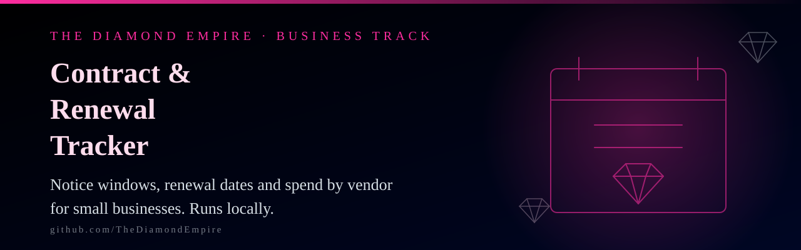

# Contract & Renewal Tracker: Client Case Study

> Never miss an auto-renewal notice window, know your commitments, and see spend by vendor.

> **Status of this document.** This is a reference case study: it sets out the business problem, the solution and the value model. The results table is intentionally blank and is filled in only from measured data (a pilot or a real engagement). No outcome figures are claimed here. The tracker behind it exists as a working local beta on synthetic data: it has never held a real contract, has no authentication, and cannot send or receive email or calendar invitations. Benchmarks on simulated workloads are in the [research report](research-report.md) and are not client outcomes. **The tracker records dates, terms and amounts that people type in. It does not read or interpret contracts and it is not legal advice: every date it shows must be checked against the contract itself.**

## Snapshot

|  |  |
|---|---|
| **Who it is for** | Owners, office managers and finance leads of small businesses (roughly 5 to 100 people) that hold a few dozen to a few hundred vendor, lease, subscription, insurance and service agreements. |
| **Solution** | A contract register that knows each agreement's term, renewal rule and notice period, computes the date by which notice must be given, reminds the right person on a schedule, escalates when nobody has decided, and shows committed spend by vendor and month. |
| **Track** | Business |
| **Delivered by** | The Diamond Empire (https://thedempire.shop/) |

## The challenge

Contracts live in a shared drive, an inbox and the memory of whoever signed them. Many renew automatically unless someone gives notice 30, 60 or 90 days before the term ends. The date that matters is rarely the end date: it is the notice deadline, which moves with month lengths, weekends, holidays and "business days" counted backwards. Nobody owns the calendar, so a renewal is discovered when the invoice arrives, and a year of an unwanted subscription is already committed. Questions as simple as "what do we spend with this vendor?" or "which contracts renew next quarter?" take a day of digging.

## The solution

A single-tenant tracker. Each contract has an owner, a term, a renewal rule, a notice rule and a holiday calendar, and the tracker works out the whole timeline of renewal dates and notice deadlines. Reminders are data (for example 90, 60, 30 and 7 days before the deadline), a decision (renew, renegotiate or cancel) can be assigned and is recorded with an audit trail, and unresolved deadlines escalate to a manager and then to a named contact.

What the client gets in practice:

- A register of vendors, contracts, amendments, obligations, owners and document records (name and location only; the tracker never reads or stores the files)
- A date engine that handles month-end clamping, leap years, calendar or business-day notice with holiday calendars and weekend rolls, and time zones
- Reminder schedules and escalation rules as data, snooze and acknowledge, and an outbox that records every message the tracker would send
- A local web UI: dashboard of upcoming deadlines, contract page with decision workflow, calendar and timeline views, filters, plus a JSON API
- `.ics` export of deadlines for the client's own calendar, and CSV import and export with per-row validation errors
- Reports: committed spend by vendor and by month, a 12-month renewal calendar, a notice-window risk list and savings recorded when a decision renegotiates or cancels (numbers the team types in)

## How it creates value

| Value lever | How the solution delivers it | How we measure it |
|---|---|---|
| Avoided unwanted renewals | The notice deadline is computed, owned and reminded, and escalated if undecided | Notice deadlines missed for contracts the team intended to cancel or renegotiate |
| Visibility of commitments | Every contract has terms, an owner and a computed timeline; spend is reported by vendor and month | Share of contracts with an owner and complete terms; committed spend for the next 12 months |
| Negotiation lead time | Reminders start early enough to renegotiate rather than just cancel | Days between first reminder and decision; decisions made before the deadline |
| Less admin | Import from a spreadsheet; one place for deadlines; calendar export | Time to answer "what renews next quarter?" |
| Savings | Renegotiated or cancelled contracts record the annual saving the team expects | Savings recorded (user-entered, not verified against invoices) |

## How an engagement runs

| Phase | What happens |
|---|---|
| Model | Capture contracts, terms, notice rules, holiday calendars, owners, managers and reminder schedules; load them from the client's spreadsheet through the CSV import, which reports every problem row |
| Check | Walk the computed notice deadlines with the people who know the contracts and correct any term that was entered wrongly. The tracker does not interpret contracts: this review is the control |
| Connect | Add real email delivery for the outbox and sign-in. Engagement work, not built |
| Pilot | One team for one renewal season with a before/after comparison of the measures above |
| Expand | Remaining departments, more calendars and local rule variants |

## What the client receives

- A configured instance with the client's contracts, owners, calendars, reminder schedules and escalation rules
- Training for the contract owners and the person who maintains the data
- A baseline report (committed spend, upcoming renewals, risk list) taken at go-live
- Integration of the client's email provider, calendar and sign-in (engagement work: the prototype has none of these)

## Results

Baseline measurements are taken **before** the solution goes live, and the same measures are taken after, so every change in the table is attributable and honest.

| Measure | How measured | Baseline | After | Change |
|---|---|---|---|---|
| Notice deadlines missed | Deadlines for contracts the team wanted to cancel or renegotiate that passed without notice, over one renewal season | — | — | — |
| Contracts with an owner and complete terms | Share of the register | — | — | — |
| Lead time of decisions | Median days between first reminder and decision | — | — | — |
| Committed spend known | Next-12-months committed spend by vendor, from the register | — | — | — |
| Savings recorded | Sum of user-entered annual savings on renegotiate or cancel decisions | — | — | — |

> **To fill in:** replace each — with measured values and add the measurement window and sample size beneath the table.

## How quality and risk are managed

- Automated tests for the date arithmetic (month ends, leap years including 2100, business days with holidays, daylight-saving days), the reminder, escalation and decision workflow, the CSV and calendar exports and the web UI and API; counts are in the README
- The date engine is checked against an independent day-by-day reference on thousands of randomized contracts (experiment E1 in the research report), and the check is proven able to catch thirteen kinds of deliberate bug
- Every decision, assignment, acknowledgement, snooze and escalation is in an audit trail
- The CSV importer is strict on purpose: ambiguous dates, European decimals or malformed rows are reported by row, never guessed at (experiment E3)
- Everything runs locally on `127.0.0.1`; the demo contains only invented companies and role names, and the outbox never sends anything
- Known limits are stated plainly in the README and the research report: no authentication, no real email or calendar sync, a rule-based stand-in for time zones on machines without the IANA database, deadline dates that are only as right as the terms entered, and simulated rather than real behaviour in the alert-policy experiment

## Is this a fit?

Best suited to a small business that wants a clear, inspectable register it can own and adapt, and that is willing to have email delivery and sign-in added in an engagement and to review the computed dates with the people who know the contracts. It is **not** a contract-lifecycle suite: it does not read contract text, extract clauses, manage drafting or signature, reconcile invoices, convert currencies or give legal advice.

## Talk to us

Want this adapted to your business? Get in touch via **[thedempire.shop](https://thedempire.shop/)**.

---

[README](../README.md) · [Client case study](case-study.md) · [Research report](research-report.md)
